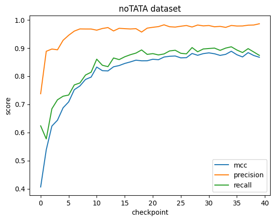
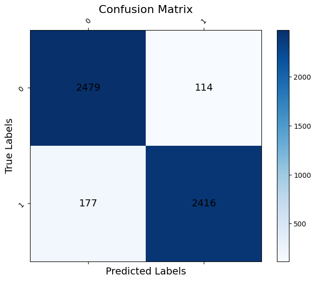
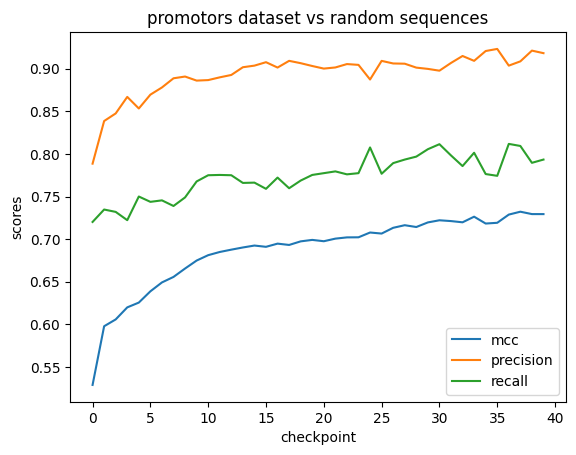
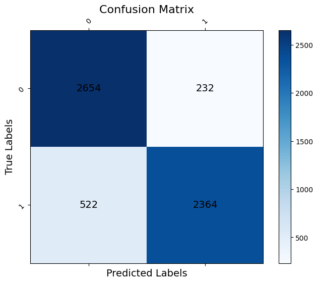
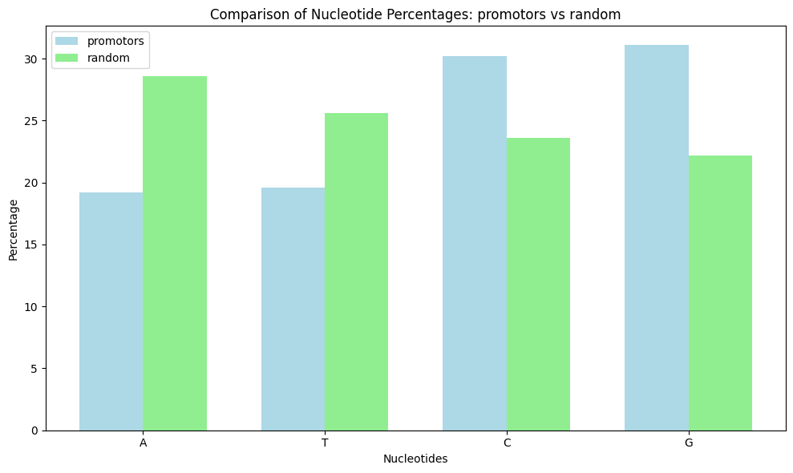

<picture>
  <source media="(prefers-color-scheme: dark)" srcset="assets/visual-abstract-dark.svg">
  
</picture>

<h1 align="center">DeePromoter in PyTorch: Promoter Prediction under Stress</h1>

<p align="center">
  A hybrid CNN and BiLSTM for eukaryotic promoter prediction, trained, evaluated with MCC and then stress-tested against real genomic DNA
</p>

<p align="center">
  
  
  
  
  
</p>

<p align="center">
  <a href="#overview">Overview</a> &nbsp;·&nbsp; <a href="#results">Results</a> &nbsp;·&nbsp; <a href="#what-i-did-and-the-purpose">Approach</a> &nbsp;·&nbsp; <a href="#the-script">Script</a> &nbsp;·&nbsp; <a href="#credits">Credits</a>
</p>

---

## At a glance

| **0.867** | **90%** | **0.729** | **87%** | **28,849** |
|:---:|:---:|:---:|:---:|:---:|
| MCC, original benchmark | random DNA called promoter | MCC, genomic negatives | accuracy, genomic negatives | sequences per class |

> **Take-home:** DeePromoter scores an MCC of 0.867 on its own benchmark, yet it calls 90% of random genomic DNA a promoter, because its negatives are modified promoters rather than real genomic sequence. Retraining on genuine genomic negatives gives a more honest MCC of 0.729, which shows how strongly the choice of negative set shapes reported performance.

## Skills demonstrated

| Area | Evidence in this repository |
|---|---|
| **Deep learning** | A PyTorch multi-kernel CNN (kernel widths 27, 14 and 7) combined with a bidirectional LSTM for sequence classification |
| **Genomic sequence modeling** | One-hot encoding of DNA, promoter versus non-promoter datasets and nucleotide composition analysis |
| **Model evaluation** | Matthews correlation coefficient, precision, recall and confusion matrices, with checkpointing on the best MCC |
| **Critical benchmarking** | Stress tests on random genomic DNA that expose shortcut learning, followed by retraining with realistic negatives |
| **Python** | PyTorch, NumPy, scikit-learn and matplotlib on a GPU runtime |

## Overview

This project implements **DeePromoter**, a hybrid deep learning model that predicts eukaryotic promoters from DNA sequence. Identifying promoter regions matters in bioinformatics, since promoters regulate where gene transcription starts. Beyond reproducing the model, the project asks a harder question: does strong benchmark performance mean the model has actually learned what a promoter is?

The pipeline covers:

- Preprocessing DNA sequences into one-hot encoded tensors
- Training a multi-kernel CNN combined with a BiLSTM
- Evaluating performance with the **Matthews correlation coefficient (MCC)**, which is more robust than accuracy for genomic data
- Stress-testing the trained model on random genomic DNA and retraining it with realistic negatives

## Results

### 1. The original benchmark looks excellent

On the human non-TATA dataset, where negatives are modified copies of promoters, the model reaches **MCC 0.867** (precision 0.986, recall 0.874) on validation and 94% accuracy on the test set.

<p>
  
  
</p>

### 2. Random genomic DNA exposes a shortcut

Given 25,920 completely random human genomic sequences, the same model calls **90% of them promoters**, almost the same rate as for true promoters (94%). Consequently, the model has mainly learned to tell intact sequence from modified sequence, rather than promoters from the rest of the genome.

### 3. Retraining with genomic negatives gives an honest estimate

Retraining with real promoters as positives and an equal number (28,849 per class) of random non-promoter genomic sequences as negatives gives **MCC 0.729** (precision 0.918, recall 0.793) and **87% test accuracy**. These scores are lower, yet they describe a model that solves the intended task.

<p>
  
  
</p>

### 4. Base composition is part of the signal

Promoters are markedly richer in G and C than random genomic sequence. GC content is typical of promoters, although not every promoter is GC-rich, so composition alone cannot identify all promoter types.



## What I did and the purpose

As part of my Master's research in Molecular Bioscience (Systems Biology) at Heidelberg University, I adapted the DeePromoter code to:

- **Implement a hybrid architecture:** a convolutional neural network extracts local motifs (such as TATA boxes), while a bidirectional LSTM captures longer-range sequence dependencies.
- **Use multi-kernel scanning:** kernel sizes of 27, 14 and 7 scan the sequence at several resolutions at once.
- **Evaluate reliably:** MCC is the primary metric, so the model is judged on separating real promoters from challenging negatives rather than random noise.
- **Automate training:** the training loop checkpoints the model regularly, keeps the best-MCC weights and stops early once performance plateaus.
- **Stress-test the result:** random genomic sequences and a retrained model reveal how much of the original performance came from the construction of the negative set.

## The script

This is the core training logic used in the repository. It sets up the local environment and runs the main training loop.

<details>
<summary><b>Show the training script</b></summary>

```python
import torch
import torch.optim as optim
from torch import nn
from icecream import ic
from pathlib import Path
import os
import sys

# Step 1: Fix environment to avoid ModuleNotFound errors
if "DeePromoter" in os.listdir() and not os.getcwd().endswith("DeePromoter"):
    os.chdir("DeePromoter")

# Step 2: Ensure local modules are prioritized
sys.path.insert(0, os.getcwd())

# Import local architecture and dataloaders
from modules.deepromoter import DeePromoter
from dataloader import load_data
from model_eval import evaluate, mcc # Renamed 'test' to 'model_eval' to avoid built-in conflicts

device = torch.device('cuda' if torch.cuda.is_available() else 'cpu')

def train(data_path, pretrain=None, exp_name="promoter_test", training=True, ker=None, epoch_num=1000):
    if ker is None:
        ker = [27, 14, 7] # Multi-kernel sizes for CNN scanning

    # Set up output directory
    exp_folder = Path("./output").joinpath(exp_name)
    exp_folder.mkdir(parents=True, exist_ok=True)

    ic("Loading DNA sequence data...")
    data = load_data(data_path, device=device)
    train_pos, val_pos, _, train_neg, val_neg, _ = data

    # Initialize Hybrid CNN-BiLSTM Model
    model = DeePromoter(ker)
    model.to(device)

    if pretrain:
        model.load_state_dict(torch.load(pretrain))

    criterion = nn.CrossEntropyLoss()
    optimizer = optim.Adam(model.parameters(), lr=1e-5)
    
    mcc_scores = []
    best_mcc, counter, patience = 0, 0, 10

    ic("Starting Deep Learning Training Loop")
    if training:
        for epoch in range(epoch_num):
            model.train()
            for (batch_pos, batch_neg) in zip(train_pos, train_neg):
                inputs = torch.cat((batch_pos[0], batch_neg[0]), 0)
                labels = torch.cat((batch_pos[1], batch_neg[1]), 0)

                optimizer.zero_grad()
                out = model(inputs)
                loss = criterion(out, labels.long())
                loss.backward()
                optimizer.step()

            # Validation phase every 10 epochs
            if epoch % 10 == 0:
                model.eval()
                with torch.no_grad():
                    eval_data, _ = evaluate(model, [val_pos, val_neg])
                    prec, rec, current_mcc = mcc(eval_data)
                
                mcc_scores.append(current_mcc)
                ic(epoch, current_mcc, prec, rec)

                # Save the current state
                torch.save(model.state_dict(), f"{exp_folder}/epoch_{epoch}.pth")

                # Track best performance (MCC)
                if current_mcc > best_mcc:
                    best_mcc = current_mcc
                    torch.save(model.state_dict(), f"{exp_folder}/best_mcc.pth")
                    counter = 0
                else:
                    counter += 1
                
                if counter >= patience:
                    ic("Early stopping: Model converged.")
                    break
                    
    return mcc_scores
```

</details>

## How to run

The notebook runs on Google Colab with a GPU runtime:

```bash
git clone https://github.com/egochao/DeePromoter.git
cd DeePromoter
pip install icecream
```

Then open `Completed_deepromoter_exercise.ipynb`. Training each model takes about one hour on a GPU, so the notebook can also load pretrained weights.

## Credits

This project builds on the open-source PyTorch implementation of DeePromoter at [egochao/DeePromoter](https://github.com/egochao/DeePromoter), which implements the architecture described by Oubounyt et al. (2019).

## License

Released under the [MIT License](LICENSE).
